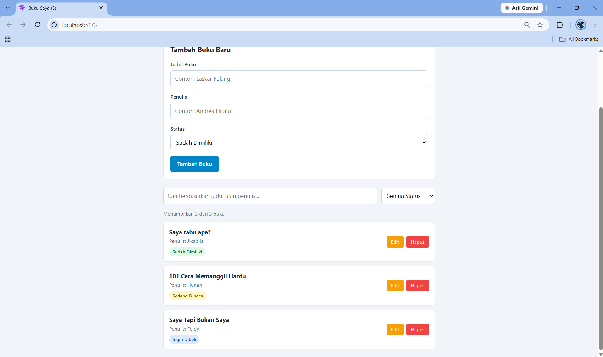
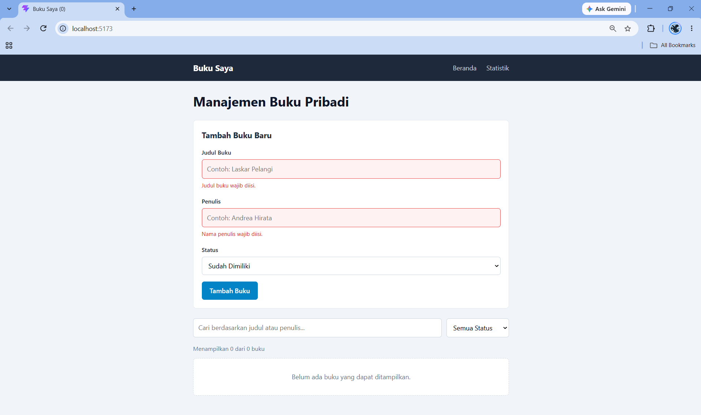
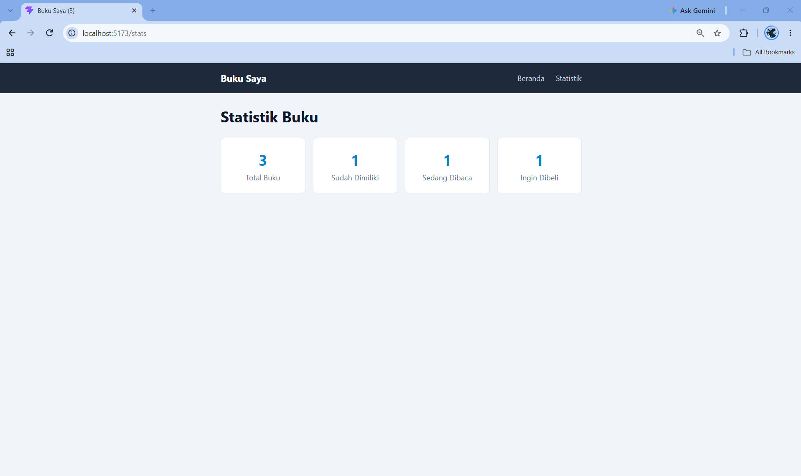
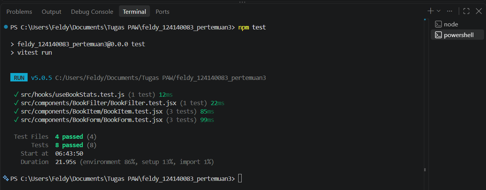

# Aplikasi Manajemen Buku Pribadi

Aplikasi web sederhana untuk mencatat koleksi buku pribadi, baik buku yang sudah dimiliki, sedang dibaca, maupun yang ingin dibeli. Aplikasi ini dibuat sebagai tugas Praktikum Pengembangan Aplikasi Web (PAW) Pertemuan 3 (React Basics), Teknik Informatika, Institut Teknologi Sumatera.

**Identitas Pembuat**

- Nama: Feldy
- NIM: 124140083

## Fitur Aplikasi

- Menambah buku baru dengan judul, penulis, dan status (milik, sedang dibaca, atau ingin dibeli).
- Mengedit dan menghapus buku.
- Menyaring buku berdasarkan status.
- Mencari buku berdasarkan judul atau nama penulis.
- Validasi formulir: judul dan penulis wajib diisi, disertai umpan balik visual berupa bingkai merah dan pesan kesalahan.
- Halaman statistik yang menampilkan jumlah buku pada setiap status.
- Penyimpanan data di `localStorage` sehingga data tidak hilang saat halaman dimuat ulang.

## Teknologi yang Digunakan

React (dibuat dengan Vite), React Router DOM, PropTypes, Vitest, dan React Testing Library.

## Instalasi dan Cara Menjalankan

Prasyarat: Node.js versi LTS (18 atau lebih baru) dan npm.

1. Masuk ke folder project:

   ```bash
   cd Feldy_124140083_pertemuan3
   ```

2. Pasang seluruh dependensi:

   ```bash
   npm install
   ```

3. Jalankan aplikasi dalam mode pengembangan:

   ```bash
   npm run dev
   ```

4. Buka alamat yang tampil di terminal, umumnya `http://localhost:5173`.

## Menjalankan Pengujian

```bash
npm test
```

Terdapat 8 unit test yang mencakup komponen `BookForm`, `BookItem`, `BookFilter`, serta custom hook `useBookStats`.

## Struktur Folder

```
src/
├── components/
│   ├── BookFilter/   (pencarian dan filter status)
│   ├── BookForm/     (formulir tambah dan edit buku)
│   ├── BookItem/     (tampilan satu buku)
│   ├── BookList/     (daftar buku)
│   └── Navbar/       (navigasi)
├── constants/book.js (daftar status dan validasi tipe data buku)
├── context/BookContext.jsx
├── hooks/
│   ├── useLocalStorage.js
│   └── useBookStats.js
├── pages/
│   ├── Home/
│   └── Stats/
└── App.jsx
```

## Penjelasan Fitur React yang Digunakan

- **Functional components dan props**: seluruh komponen berupa fungsi. Data dan fungsi dikirim dari komponen induk ke komponen anak melalui props.
- **PropTypes**: setiap komponen yang menerima props divalidasi tipenya.
- **useState**: mengelola isi formulir, pesan kesalahan, kata kunci pencarian, filter status, dan buku yang sedang diedit.
- **useEffect**: digunakan pada `useLocalStorage` untuk menyimpan data ke `localStorage`, dan pada halaman Home untuk memperbarui judul tab browser.
- **useMemo**: digunakan pada `useBookStats` agar statistik dihitung ulang hanya ketika daftar buku berubah.
- **Custom hooks**: `useLocalStorage` (penyimpanan persisten) dan `useBookStats` (perhitungan statistik).
- **Context API**: `BookContext` menyediakan data buku beserta fungsi tambah, ubah, dan hapus ke seluruh komponen tanpa prop drilling.
- **React Router**: dua halaman, yaitu Beranda (`/`) dan Statistik (`/stats`), dengan navigasi tanpa memuat ulang halaman.
- **Controlled component, conditional rendering, dan list rendering**: digunakan pada formulir, pesan kesalahan, serta daftar buku (dengan atribut `key`).

## Screenshot

**Halaman Beranda**



**Validasi Formulir**



**Halaman Statistik**



## Laporan Testing

