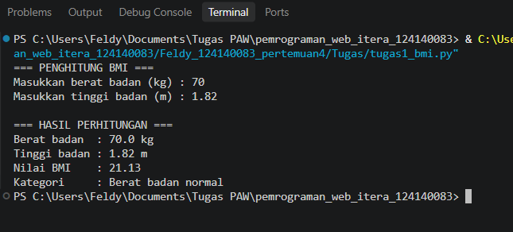
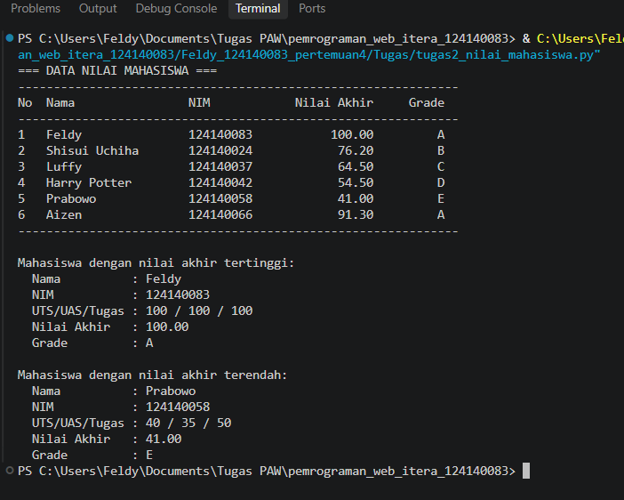
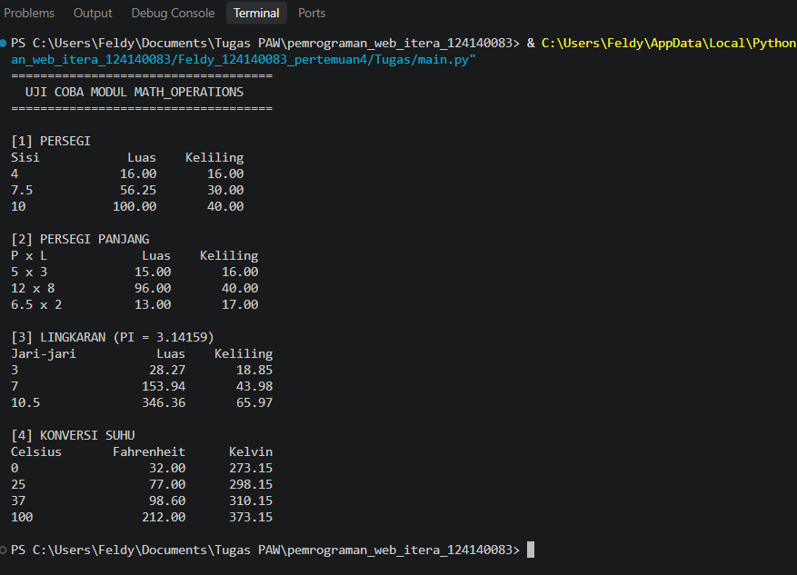

# Tugas Praktikum Pengembangan Aplikasi Web - Pertemuan 4 (Python Dasar)

Nama: Feldy
NIM: 124140083

Ini tugas pertemuan 4 yang isinya tiga program Python: penghitung BMI, pengelolaan nilai mahasiswa, dan modul matematika beserta program yang memakainya. Semuanya di run lewat terminal di VS Code dan tidak butuh library tambahan, hanya Python bawaan.

## Isi folder

```
Feldy_124140083_pertemuan4/
├── .gitignore
├── README.md
├── tugas1_bmi.py
├── tugas2_nilai_mahasiswa.py
├── math_operations.py
├── main.py
└── screenshots/
```

## Penjelasan program

### 1. tugas1_bmi.py - Hitung BMI

Program meminta berat badan (kg) dan tinggi badan (m) lewat input(), lalu BMI dihitung dengan rumus berat / (tinggi * tinggi). Hasilnya dicocokkan ke kategori memakai if-elif-else:

| BMI | Kategori |
|---|---|
| kurang dari 18.5 | Berat badan kurang |
| 18.5 sampai kurang dari 25 | Berat badan normal |
| 25 sampai kurang dari 30 | Berat badan berlebih |
| 30 ke atas | Obesitas |

Nilai BMI ditampilkan dengan 2 angka di belakang koma, lalu diikuti kategorinya. Tinggi badan harus diisi dalam satuan meter (misalnya 1.7), bukan cm, dan inputnya harus berupa angka.

### 2. tugas2_nilai_mahasiswa.py - Pengelola Nilai Mahasiswa

Datanya berupa list yang isinya 6 dictionary mahasiswa, masing-masing punya kunci nama, nim, nilai_uts, nilai_uas, dan nilai_tugas. Flow :

1. Nilai akhir tiap mahasiswa dihitung: 30% UTS + 40% UAS + 30% Tugas.
2. Grade ditentukan dari nilai akhir (A: 80 ke atas, B: 70-79, C: 60-69, D: 50-59, E: di bawah 50).
3. Semua data dicetak dalam bentuk tabel (Nama, NIM, Nilai Akhir, Grade).
4. Mahasiswa dengan nilai akhir tertinggi dan terendah dicari pakai max() dan min(), lalu rinciannya ditampilkan.

Data contohnya dibuat mencakup semua grade dari A sampai E supaya semua cabang penilaian teruji.

### 3. math_operations.py dan main.py - Modul Matematika

math_operations.py adalah modulnya. Isinya:

- konstanta PI = 3.14159 dan SELISIH_KELVIN = 273.15
- luas dan keliling untuk persegi, persegi panjang, dan lingkaran
- konversi suhu Celsius ke Fahrenheit dan Celsius ke Kelvin

main.py yang memanggil modul tersebut. Semua fungsi dicoba dengan beberapa nilai uji dan hasilnya dicetak dalam bentuk tabel kecil per bagian. Dua cara impor yang dipakai:

- import math_operations untuk fungsi bangun datar, dipanggil dengan awalan math_operations.
- from math_operations import celsius_ke_fahrenheit, celsius_ke_kelvin, PI untuk konversi suhu dan konstanta PI

## Cara menjalankan

Buka folder ini (Tugas) di VS Code, buka terminalnya, lalu run:

```bash
python tugas1_bmi.py
python tugas2_nilai_mahasiswa.py
python main.py
```

Bila perintah python tidak dikenali, ganti dengan python3.

Untuk tugas1_bmi.py, nanti diminta mengisi berat dan tinggi badan dulu, contohnya 65 lalu 1.7. Untuk dua file lainnya tidak ada input, langsung muncul hasil. math_operations.py tidak perlu dijalankan sendiri karena hanya dipakai lewat main.py.

## Screenshot hasil eksekusi

**Soal 1 - BMI**



**Soal 2 - Nilai mahasiswa**



**Soal 3 - Modul matematika**


