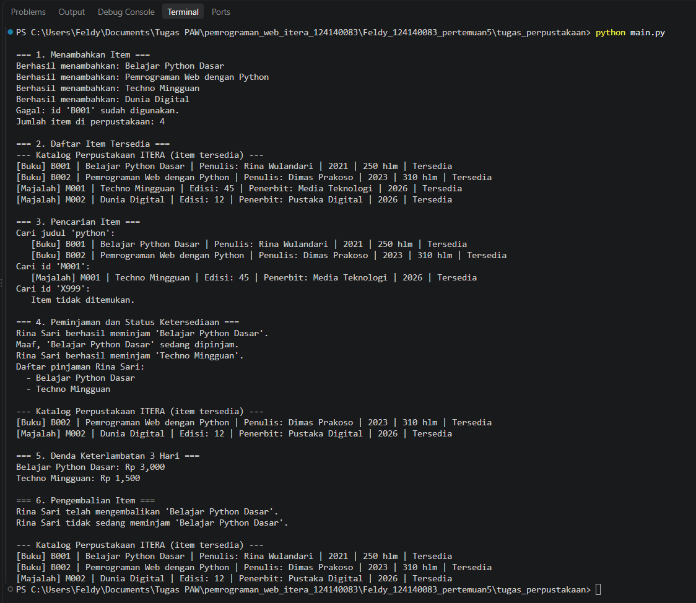

# Praktikum Pengembangan Aplikasi Web - Pertemuan 5: Python OOP

Repositori ini berisi hasil praktikum Pertemuan 5 tentang Pemrograman Berorientasi Objek (OOP) di Python. Isinya terdiri dari latihan pada modul (hands-on dan latihan mandiri) serta tugas Sistem Manajemen Perpustakaan Sederhana.

## Identitas Mahasiswa

- **Nama Lengkap:** Feldy
- **NIM:** 124140083
- **Kelas Praktikum:** RB
- **Program Studi:** Teknik Informatika, Institut Teknologi Sumatera

## Struktur Folder

    Feldy_124140083_pertemuan5/
    ├── latihan/
    │   ├── 01_everything_is_object.py
    │   ├── 01_procedural_vs_oop.py
    │   ├── 02_class_object.py
    │   ├── 03_inheritance.py
    │   ├── 04_encapsulation.py
    │   ├── 05_polymorphism.py
    │   └── 06_abstract_class.py
    ├── tugas_perpustakaan/
    │   ├── library_item.py
    │   ├── member.py
    │   ├── library.py
    │   └── main.py
    ├── screenshots/
    ├── README.md
    └── .gitignore

## Latihan pada Modul

Folder **latihan/** berisi seluruh hands-on dari modul. Latihan mandiri ditulis di berkas yang sama dengan bagian materinya, tepat di bawah kode hands-on, dan diberi komentar penanda **LATIHAN MANDIRI**.

Berikut rincian latihan yang dikerjakan:

- **01_everything_is_object.py**
  - Hands-on: Konsep "everything is an object".
  - Latihan mandiri: Tidak ada.

- **01_procedural_vs_oop.py**
  - Hands-on: Perbandingan pemrograman prosedural dan OOP.
  - Latihan mandiri: Pemodelan entitas sistem kasir toko.

- **02_class_object.py**
  - Hands-on: Class, object, dan dunder method.
  - Latihan mandiri: Class Buku dengan diskon dan method __len__.

- **03_inheritance.py**
  - Hands-on: Inheritance, super(), dan MRO.
  - Latihan mandiri: Subclass Truk.

- **04_encapsulation.py**
  - Hands-on: Access modifier dan @property.
  - Latihan mandiri: Class Karyawan dengan validasi gaji.

- **05_polymorphism.py**
  - Hands-on: Polymorphism dan operator overloading.
  - Latihan mandiri: Notifikasi multi-saluran.

- **06_abstract_class.py**
  - Hands-on: Abstract class dan interface.
  - Latihan mandiri: Interface FileStorage.

## Tugas: Sistem Manajemen Perpustakaan Sederhana

### Deskripsi Program

Program ini mengelola koleksi perpustakaan yang berisi buku dan majalah. Pengguna dapat menambahkan item, melihat daftar item yang tersedia, mencari item berdasarkan judul atau ID, serta mencatat peminjaman dan pengembalian oleh anggota.

Alur program di **main.py** berjalan seperti berikut:

1. Membuat perpustakaan, lalu menambahkan dua buku dan dua majalah.
2. Menampilkan daftar item yang tersedia.
3. Mencari item berdasarkan judul dan ID.
4. Seorang anggota meminjam item, kemudian daftar tersedia ditampilkan lagi sehingga item yang dipinjam tidak muncul.
5. Menghitung denda keterlambatan untuk buku dan majalah.
6. Mengembalikan item, lalu menampilkan daftar tersedia sekali lagi.

### Penerapan Konsep OOP

**Class**

Program dibagi menjadi beberapa class dengan tugas masing-masing:

- **LibraryItem:** Class dasar untuk seluruh item perpustakaan.
- **Book:** Class untuk merepresentasikan buku.
- **Magazine:** Class untuk merepresentasikan majalah.
- **Library:** Class untuk mengelola koleksi perpustakaan.
- **Member:** Class untuk merepresentasikan anggota yang melakukan peminjaman.

**Inheritance**

LibraryItem merupakan abstract class yang mewarisi ABC. Class Book dan Magazine mewarisi LibraryItem sehingga dapat menggunakan kembali atribut dan method umum seperti pinjam() dan kembalikan().

Kedua subclass wajib mengimplementasikan dua abstract method, yaitu get_detail() dan hitung_denda().

**Encapsulation**

Data penting dilindungi menggunakan access modifier:

- _id_item dan _tahun_terbit bersifat protected.
- __dipinjam pada LibraryItem, __koleksi pada Library, dan __daftar_pinjaman pada Member bersifat private, sehingga pengaksesannya dilakukan melalui method yang disediakan.
- Decorator @property digunakan pada id_item, judul (dengan setter yang menolak judul kosong), dan is_dipinjam.

**Polymorphism**

Library memanggil method get_detail() pada setiap item tanpa perlu memeriksa jenis item terlebih dahulu. Hasil yang ditampilkan akan berbeda sesuai objeknya, baik buku maupun majalah.

Hal yang sama diterapkan pada method hitung_denda(). Buku dikenakan denda Rp1.000 per hari, sedangkan majalah dikenakan denda Rp500 per hari.

## Panduan Menjalankan Program

Pastikan Python versi 3.10 atau yang lebih baru sudah terpasang. Pengecekan versi dapat dilakukan melalui terminal dengan perintah berikut:

    python --version

**Menjalankan program tugas:**

    cd tugas_perpustakaan
    python main.py

**Menjalankan salah satu latihan**, misalnya latihan inheritance:

    cd latihan
    python 03_inheritance.py

Program tidak membutuhkan library tambahan karena hanya menggunakan modul bawaan Python.

## Screenshot Output

Tangkapan layar berikut diambil dari terminal saat **python main.py** dijalankan. Hasilnya menunjukkan fitur menambahkan item, menampilkan daftar item tersedia, mencari item berdasarkan judul dan id, serta peminjaman dan pengembalian item.

