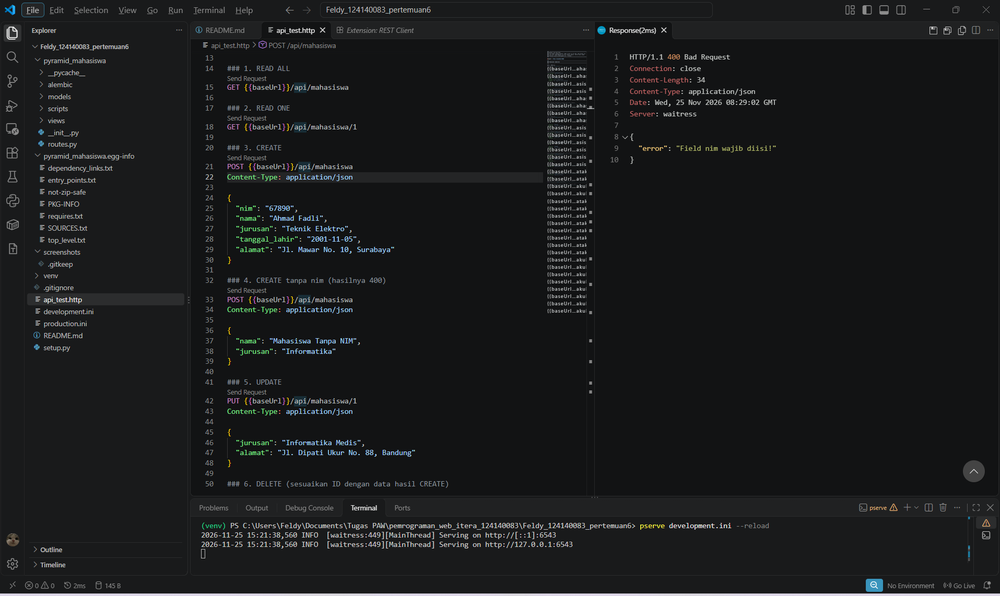
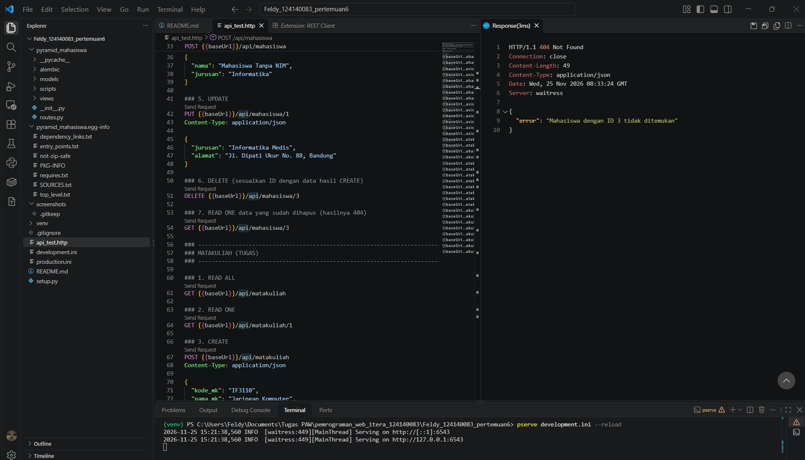
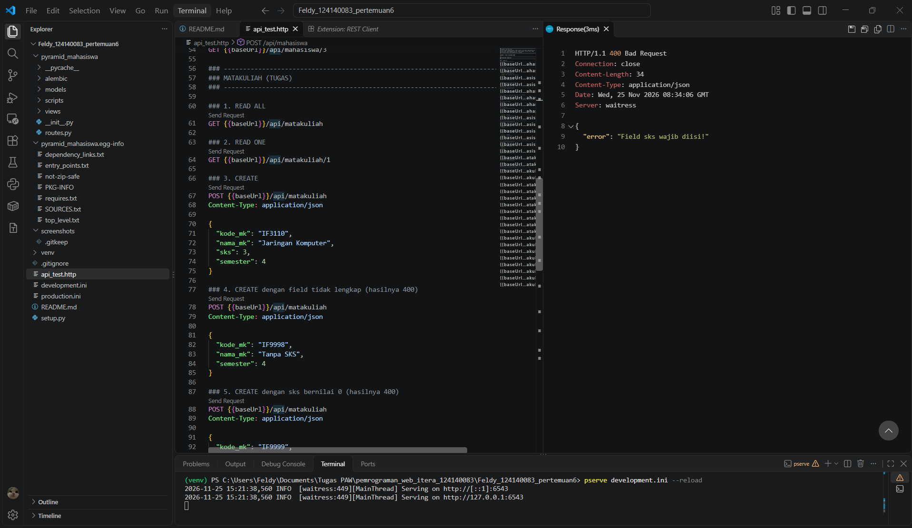
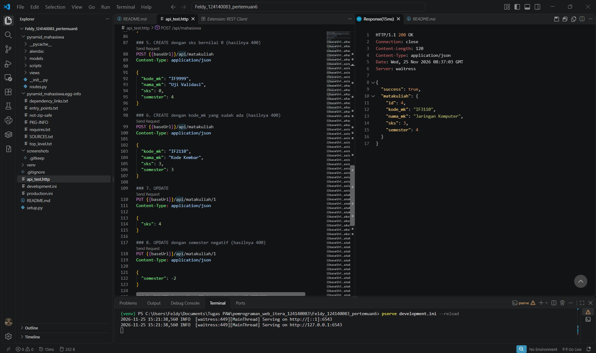
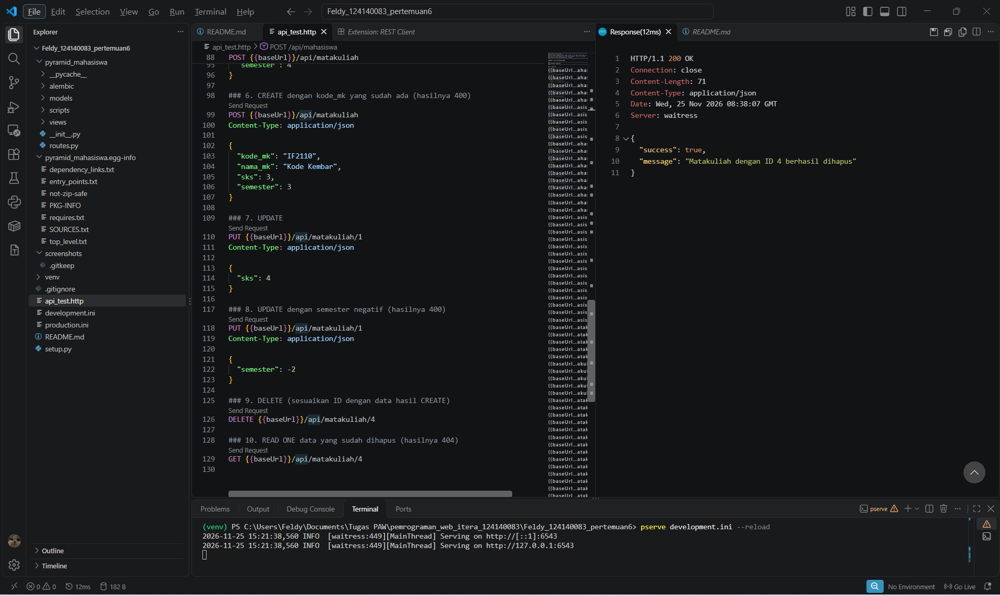
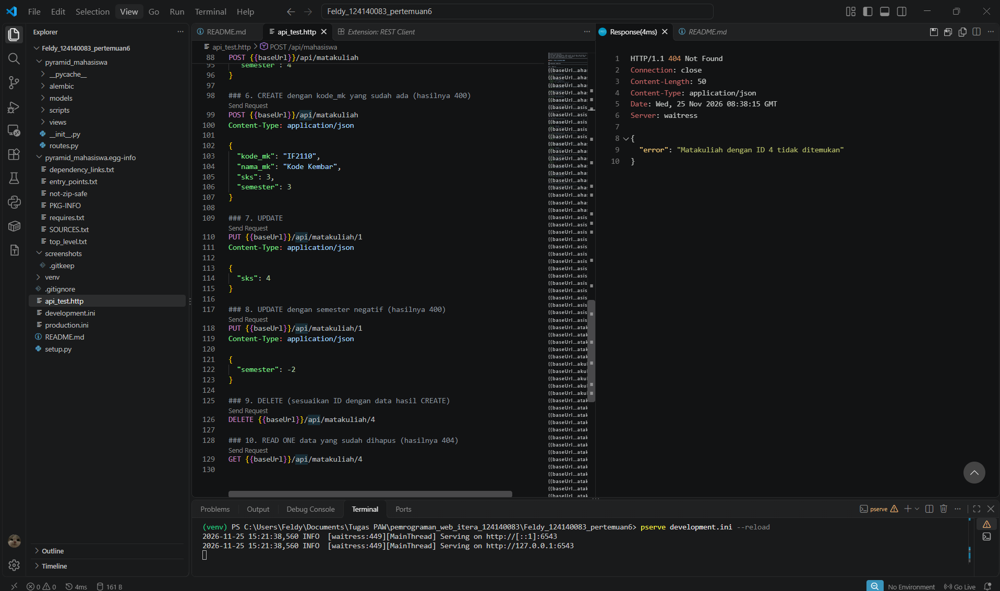

# Praktikum Pengembangan Aplikasi Web - Pertemuan 6: Pyramid Framework

Repositori ini berisi hasil praktikum Pertemuan 6, yaitu aplikasi RESTful API yang dibuat dengan Pyramid Framework dan database PostgreSQL. Aplikasi ini mengelola dua jenis data: **Mahasiswa** (dibuat pada langkah praktikum) dan **Matakuliah** (dibuat sebagai tugas).

## Identitas Praktikan

Nama Lengkap = Feldy

NIM = 124140083

Kelas Praktikum = RB  
    
Program Studi = Teknik Informatika, Institut Teknologi Sumatera

## Deskripsi Aplikasi

Aplikasi ini menyediakan API untuk melakukan operasi CRUD (Create, Read, Update, Delete) pada dua tabel di PostgreSQL. Seluruh data dikirim dan diterima dalam format JSON.

Teknologi yang digunakan:

- **Pyramid** sebagai framework web dengan URL Dispatch.
- **SQLAlchemy** sebagai ORM untuk memetakan tabel menjadi class Python.
- **Alembic** untuk mengelola migrasi skema database.
- **PostgreSQL** sebagai database.
- **pyramid_tm** dan **zope.sqlalchemy** agar transaksi database berjalan otomatis pada setiap request.

Pembagian bagian praktikum dan tugas dapat dikenali dari komentar di dalam kode:

- Komentar `HANDS-ON` menandai bagian yang dikerjakan mengikuti langkah modul (model, view, dan route Mahasiswa).
- Komentar `TUGAS` menandai bagian yang ditambahkan untuk tugas (model, view, route, migrasi, dan seeding Matakuliah).

## Struktur Folder

```
Feldy_124140083_pertemuan6/
├── development.ini
├── production.ini
├── setup.py
├── README.md
├── .gitignore
├── api_test.http
├── screenshots/
└── pyramid_mahasiswa/
    ├── __init__.py
    ├── routes.py
    ├── alembic/
    │   ├── env.py
    │   ├── script.py.mako
    │   └── versions/
    │       ├── 20261125_create_mahasiswa_table.py
    │       └── 20261125_create_matakuliah_table.py
    ├── models/
    │   ├── __init__.py
    │   ├── meta.py
    │   ├── mahasiswa.py
    │   └── matakuliah.py
    ├── scripts/
    │   ├── __init__.py
    │   └── initialize_db.py
    └── views/
        ├── __init__.py
        ├── default.py
        ├── mahasiswa.py
        └── matakuliah.py
```

## Langkah Instalasi dan Menjalankan Aplikasi

### 1. Prasyarat

- Python 3.11 atau 3.12 (disarankan; versi yang lebih baru mungkin belum didukung semua dependensi).
- PostgreSQL yang sudah berjalan, beserta utilitas `psql`.

### 2. Menyiapkan Virtual Environment

Buka terminal di folder `Feldy_124140083_pertemuan6`, lalu jalankan:

```bash
python -m venv venv

# Windows (PowerShell):
venv\Scripts\Activate.ps1
# macOS / Linux:
source venv/bin/activate

pip install --upgrade pip setuptools
pip install -e ".[testing]"
```

Perintah `pip install -e` akan memasang seluruh dependensi yang tercantum di `setup.py`, termasuk Pyramid, SQLAlchemy, Alembic, dan driver PostgreSQL.

### 3. Membuat Database dan User PostgreSQL

Masuk ke psql dengan `psql -U postgres`, lalu jalankan perintah berikut:

```sql
CREATE DATABASE pyramid_mahasiswa;
CREATE USER pyramid_user WITH ENCRYPTED PASSWORD 'pyramid_pass';
GRANT ALL PRIVILEGES ON DATABASE pyramid_mahasiswa TO pyramid_user;

-- Khusus PostgreSQL 15 ke atas:
\c pyramid_mahasiswa
GRANT ALL ON SCHEMA public TO pyramid_user;

\q
```

Koneksi database diatur pada baris `sqlalchemy.url` di `development.ini`. Sesuaikan jika nama user, password, atau port PostgreSQL Anda berbeda.

### 4. Menjalankan Migrasi Database

Pastikan terminal berada di folder yang sama dengan `development.ini`, lalu jalankan:

```bash
alembic -c development.ini upgrade head
```

Perintah ini menjalankan dua migrasi secara berurutan, yaitu pembuatan tabel `mahasiswa` lalu tabel `matakuliah`. Untuk memeriksa versi migrasi yang aktif, gunakan `alembic -c development.ini current`.

### 5. Mengisi Data Awal (Seeding)

```bash
python -m pyramid_mahasiswa.scripts.initialize_db development.ini
```

Skrip ini mengisi 2 data mahasiswa dan 3 data mata kuliah. Jika tabel sudah berisi data, proses seeding untuk tabel tersebut dilewati, sehingga aman dijalankan lebih dari sekali.

### 6. Menjalankan Server

```bash
pserve development.ini --reload
```

Server berjalan di `http://localhost:6543`. Opsi `--reload` membuat server memulai ulang otomatis setiap ada perubahan kode.

## Daftar Endpoint

### Mahasiswa

| Method | Endpoint              | Fungsi                              |
| ------ | --------------------- | ----------------------------------- |
| GET    | `/api/mahasiswa`      | Menampilkan seluruh mahasiswa       |
| GET    | `/api/mahasiswa/{id}` | Menampilkan detail satu mahasiswa   |
| POST   | `/api/mahasiswa`      | Menambahkan mahasiswa baru          |
| PUT    | `/api/mahasiswa/{id}` | Memperbarui data mahasiswa          |
| DELETE | `/api/mahasiswa/{id}` | Menghapus mahasiswa                 |

### Matakuliah

| Method | Endpoint               | Fungsi                                |
| ------ | ---------------------- | ------------------------------------- |
| GET    | `/api/matakuliah`      | Menampilkan seluruh mata kuliah       |
| GET    | `/api/matakuliah/{id}` | Menampilkan detail satu mata kuliah   |
| POST   | `/api/matakuliah`      | Menambahkan mata kuliah baru          |
| PUT    | `/api/matakuliah/{id}` | Memperbarui data mata kuliah          |
| DELETE | `/api/matakuliah/{id}` | Menghapus mata kuliah                 |

### Aturan Validasi dan Kode Status

- **200 OK**: permintaan berhasil diproses.
- **400 Bad Request**: data tidak lengkap atau tidak valid. Pada Matakuliah, field `kode_mk`, `nama_mk`, `sks`, dan `semester` wajib diisi, `sks` dan `semester` harus berupa angka bulat lebih besar dari 0, dan `kode_mk` tidak boleh sama dengan yang sudah ada.
- **404 Not Found**: data dengan ID yang diminta tidak ditemukan.

## Contoh Pengujian dengan cURL

Contoh berikut untuk macOS, Linux, atau Git Bash. Pada PowerShell, tulis `curl.exe` (bukan `curl`) karena `curl` adalah alias untuk perintah lain. Untuk request POST dan PUT di Windows, lebih mudah memakai berkas `api_test.http` (ekstensi REST Client di VS Code) atau Postman.

```bash
# Menampilkan seluruh mata kuliah
curl -X GET http://localhost:6543/api/matakuliah

# Menampilkan detail mata kuliah dengan ID 1
curl -X GET http://localhost:6543/api/matakuliah/1

# Menambahkan mata kuliah baru
curl -X POST http://localhost:6543/api/matakuliah \
  -H "Content-Type: application/json" \
  -d '{"kode_mk": "IF3110", "nama_mk": "Jaringan Komputer", "sks": 3, "semester": 4}'

# Menguji validasi: sks bernilai 0 (hasilnya 400)
curl -X POST http://localhost:6543/api/matakuliah \
  -H "Content-Type: application/json" \
  -d '{"kode_mk": "IF9999", "nama_mk": "Uji Validasi", "sks": 0, "semester": 4}'

# Memperbarui mata kuliah dengan ID 1
curl -X PUT http://localhost:6543/api/matakuliah/1 \
  -H "Content-Type: application/json" \
  -d '{"sks": 4}'

# Menghapus mata kuliah dengan ID 4
curl -X DELETE http://localhost:6543/api/matakuliah/4
```

Pengujian endpoint Mahasiswa memakai pola yang sama dengan alamat `/api/mahasiswa`.

## Screenshot Hasil Pengujian

Tangkapan layar berikut menunjukkan hasil pengujian seluruh endpoint, termasuk contoh respons 400 dan 404.

**Pengujian endpoint Mahasiswa — respons 400**



**Pengujian endpoint Mahasiswa — respons 404**



**Pengujian endpoint Matakuliah — respons 400**



**Pengujian endpoint Matakuliah — CREATE berhasil (200)**



**Pengujian endpoint Matakuliah — DELETE berhasil (200)**



**Pengujian endpoint Matakuliah — respons 404**


